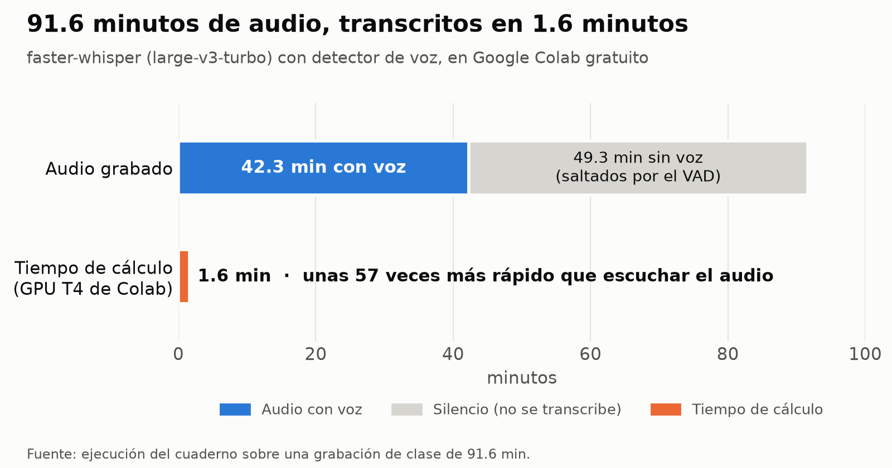

*Tool · Python on Colab*

**Question:** can a long recording be transcribed for free, quickly, and without Whisper inventing text during silences?

**Result:** 91.6 minutes of audio transcribed in 1.6 minutes on Google Colab's free GPU, about 57 times faster than listening to them; in addition, the voice detector skipped 49.3 minutes of silence.

**Approach:** a notebook was written that transcribes with faster-whisper in batches on the GPU and, through a voice activity detector, only feeds the model the segments in which someone is speaking. This prevents invented sentences during silences, which in the first version of the notebook amounted to 22 «Gracias.» («Thank you.») during the opening wait of a class. Each recording yields text in paragraphs, timed subtitles and a table for analysis; optionally, the notebook can also separate speakers and measure accuracy with the WER.

The notebook is in Spanish.

[Open in Colab](https://colab.research.google.com/github/saffron29/transcribir-audio/blob/main/WhisperTranscribe_v2.ipynb) · [Repo](https://github.com/saffron29/transcribir-audio)
