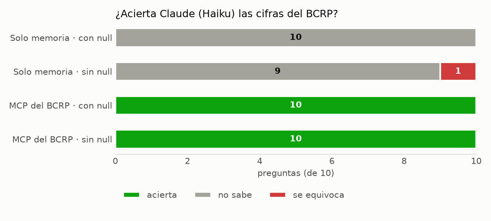

*Project · MCP and Claude Code*

**Question:** does an AI model get economic figures right more often with official data than from memory?

**Result:** 10 of 10 figures correct with the MCP server, compared with 0 of 10 without it.

**Approach:** a server was built with FastMCP that searches the 17,167 series of the Central Reserve Bank of Peru (BCRP), downloads them and computes changes, plus a custom tool to measure the correlation between two series. The model was then asked the same ten questions with and without the server: without it, it answered that it did not know in all ten and, when that answer was ruled out, got one wrong; with it, it got all ten right, and each figure came with its series, period and URL.

The report and code are in Spanish.

[Report](https://github.com/saffron29/mcp-bcrp/blob/main/informe.md) · [Repo](https://github.com/saffron29/mcp-bcrp)
