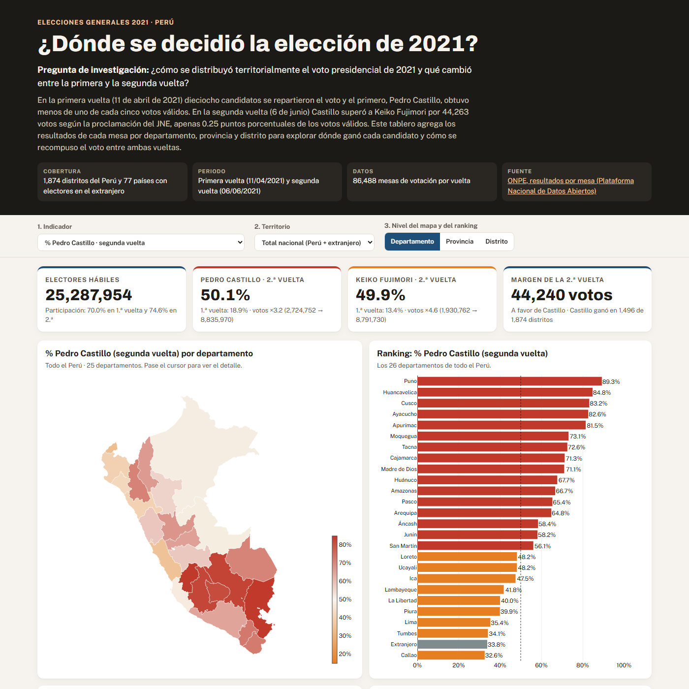

*Project · Python, Plotly and AI voice*

**Question:** how was the 2021 presidential vote distributed across the country, and what changed between the first round and the runoff?

**Result:** Castillo won in 16 of the 25 departments and obtained 152,157 more votes than Fujimori within Peru, a lead that the vote abroad cut by 107,917. In the poorest 20% of districts he won 78.0% of the valid votes, compared with 42.5% in the least poor 20%.

**Approach:** the official polling-station results of ONPE (National Office of Electoral Processes) were cleaned (86,488 polling stations in each round), aggregated by district, province and department, and merged with district-level monetary poverty from INEI (National Institute of Statistics). Building on this, a public dashboard was created with a choropleth map, a ranking, a scatter plot of poverty against the vote and the composition of the first-round vote, together with a 67-second reel that narrates the findings with an AI-generated voice based on the author's own.

The dashboard, code and reel are in Spanish.

[Dashboard](https://saffron29.github.io/tarea_3/) · [Reel](/en/videos/) · [Repo](https://github.com/saffron29/tarea_3)
