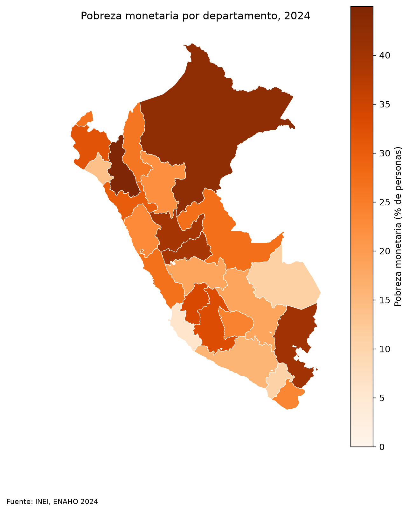

*Project · Claude Code*

**Question:** can an AI agent clean the ENAHO (National Household Survey) and replicate the official poverty rate?

**Result:** 27.58% monetary poverty in 2024, matching the official figure published by INEI (27.6%), computed over 108,664 usual residents.

**Approach:** three skills were built for an AI agent (to clean, chart and map the ENAHO), each with a Python script that follows fixed rules: survey keys are read as text, figures are weighted with the expansion factor, and departments are joined to the map by code, never by name. The agent was also evaluated with and without the skills: with them it answered the three test requests and chained the steps on its own, whereas without them it could not report the poverty rate for Cusco.

The code, evaluation and charts are in Spanish.

[Repo](https://github.com/saffron29/enaho-skills) · [Evaluation](https://github.com/saffron29/enaho-skills/blob/main/evaluacion.md) · [Map](/images/enaho-mapa-pobreza-2024.png)
