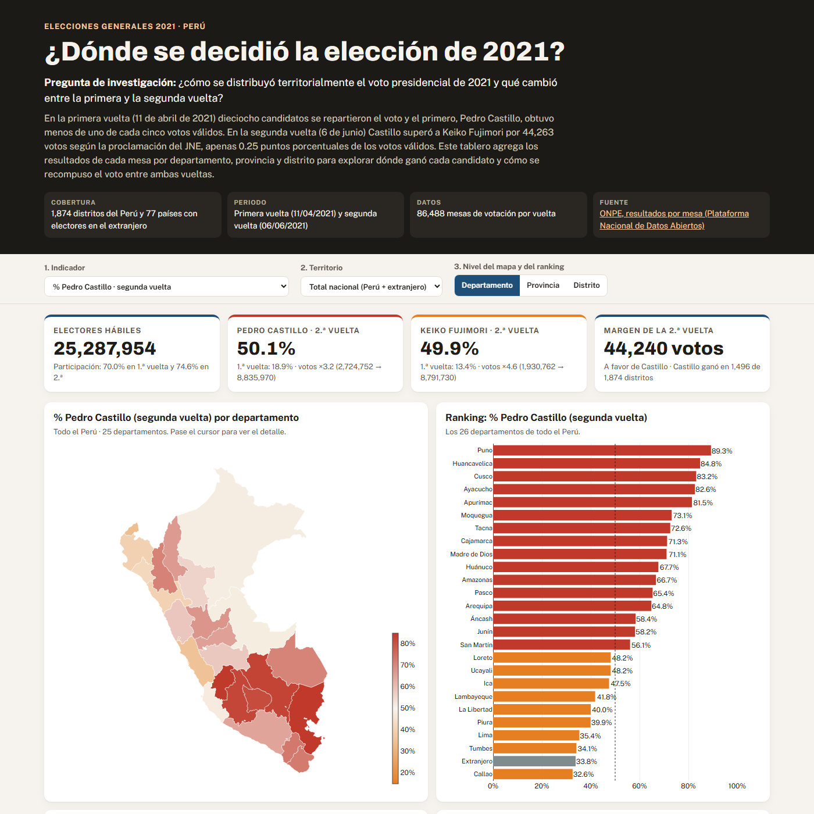

*Proyecto · Python, Plotly y voz con IA*

**Pregunta:** ¿cómo se distribuyó territorialmente el voto presidencial de 2021 y qué cambió entre la primera y la segunda vuelta?

**Resultado:** Castillo ganó en 16 de los 25 departamentos y obtuvo en el Perú 152,157 votos más que Fujimori, ventaja que el voto en el extranjero redujo en 107,917. En el 20% más pobre de los distritos obtuvo el 78.0% de los votos válidos, frente al 42.5% en el 20% menos pobre.

**Qué se hizo:** se limpiaron los resultados oficiales mesa por mesa de la ONPE (86,488 mesas en cada vuelta), se agregaron por distrito, provincia y departamento, y se cruzaron con la pobreza monetaria distrital del INEI. A partir de ello, se construyó un dashboard público con un mapa coroplético, un ranking, una dispersión entre pobreza y voto y la composición del voto de la primera vuelta, así como un reel de 67 segundos que narra los hallazgos con una voz generada con IA a partir de la voz del autor.

[Dashboard](https://saffron29.github.io/tarea_3/) · [Reel](/videos/) · [Repo](https://github.com/saffron29/tarea_3)
