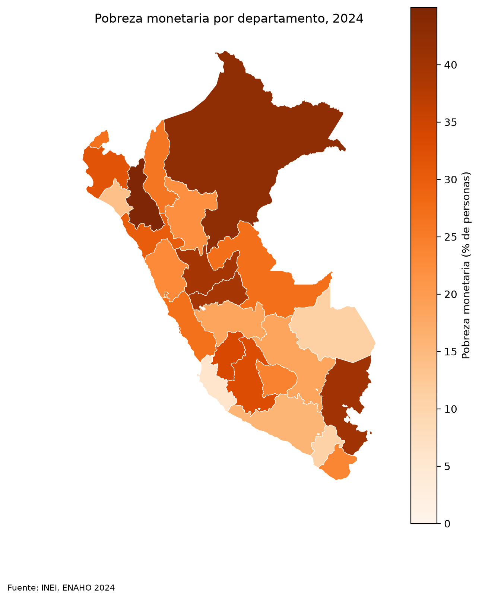

*Proyecto · Claude Code*

**Pregunta:** ¿puede un agente limpiar la ENAHO y replicar la pobreza oficial?

**Resultado:** 27.58% de pobreza monetaria en 2024, igual que la cifra oficial del INEI (27.6%), con 108,664 residentes habituales.

**Qué se hizo:** se construyeron tres skills para un agente de IA (limpiar, graficar y mapear la ENAHO), cada una con un script en Python que sigue reglas fijas: las llaves se leen como texto, las cifras se ponderan con el factor de expansión y los departamentos se unen al mapa por código, nunca por nombre. Asimismo, se evaluó al agente con y sin las skills: con ellas respondió los tres pedidos de prueba y encadenó los pasos por su cuenta, mientras que sin ellas no logró dar la pobreza de Cusco.

[Repo](https://github.com/saffron29/enaho-skills) · [Evaluación](https://github.com/saffron29/enaho-skills/blob/main/evaluacion.md) · [Mapa](/images/enaho-mapa-pobreza-2024.png)
