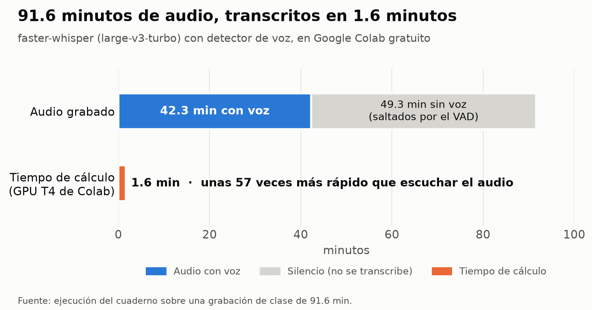

*Herramienta · Python en Colab*

**Pregunta:** ¿se puede transcribir una grabación larga gratis, rápido y sin que Whisper invente texto en los silencios?

**Resultado:** 91.6 minutos de audio transcritos en 1.6 minutos en la GPU gratuita de Google Colab, unas 57 veces más rápido que escucharlos; además, el detector de voz saltó 49.3 minutos sin voz.

**Qué se hizo:** se escribió un cuaderno que transcribe con faster-whisper por lotes en la GPU y que, mediante un detector de voz, solo le entrega al modelo los tramos en los que alguien habla. De esta forma, se evitan las frases inventadas en los silencios, que en la primera versión del cuaderno llegaron a 22 «Gracias.» durante la espera inicial de una clase. Por cada audio se obtiene un texto en párrafos, subtítulos con tiempos y una tabla para analizar, y de manera opcional se puede separar a las personas que hablan y medir la precisión con el WER.

[Abrir en Colab](https://colab.research.google.com/github/saffron29/transcribir-audio/blob/main/WhisperTranscribe_v2.ipynb) · [Repo](https://github.com/saffron29/transcribir-audio)
