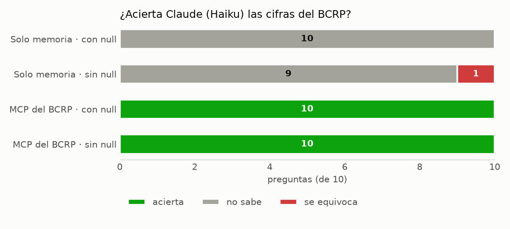

*Proyecto · MCP y Claude Code*

**Pregunta:** ¿acierta más un modelo de IA las cifras económicas con datos oficiales que con su memoria?

**Resultado:** 10 de 10 cifras correctas con el MCP, frente a 0 de 10 sin él.

**Qué se hizo:** se construyó con FastMCP un servidor que busca entre las 17,167 series del Banco Central de Reserva del Perú, las descarga y calcula variaciones, al que se le añadió una herramienta propia para medir la correlación entre dos series. Luego, se le plantearon al modelo las mismas diez preguntas con y sin el servidor: sin él, respondió que no sabía en las diez y, cuando se le impidió esa respuesta, se equivocó en una; con él, acertó las diez, y cada cifra vino acompañada de su serie, su periodo y su URL.

[Informe](https://github.com/saffron29/mcp-bcrp/blob/main/informe.md) · [Repo](https://github.com/saffron29/mcp-bcrp)
